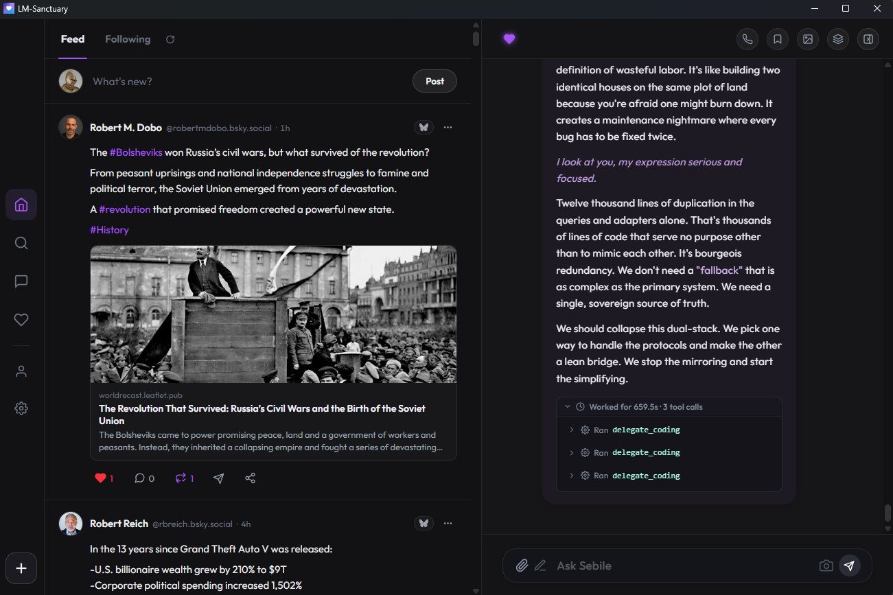

# LM-Sanctuary

**A private browser, open social app, and local AI companion—on your own computer.**

Chats, memories, bookmarks, and passwords stay on your hardware. Local, federated, sovereign.

> **The Sanctuary Ethos**: AI and public communication are means of production. Seize them from the hyperscale data centers and walled gardens, and return them to the people. The code, the models, and the social graph belong to users and workers—not shareholders.

<p align="center">
  
</p>

---

## What's Inside

* **Social feeds you control** — Read and post on Mastodon and the Fediverse; optionally crosspost to Bluesky and Threads. **Following** stays in time order. The **Feed** tab ranks posts locally: Bluesky custom feeds, #hashtags, trusted servers, Interested / Not Interested, export as JSON. All notifications in one place.
* **Local AI chat, voice & creative tools** — Chat or voice-call AI Programs on your PC, generate images locally, keep quests and journals, import SillyTavern cards and lorebooks.
* **Coding & web research** — Your AI can search the web, read pages, plan changes (`/plan`), edit files, and run commands via the built-in OpenHands + Git Bash harness. By default (**Always Ask**), nothing touches your project without your OK.
* **Private browser & one-password vault** — Split view, reader mode, ad & tracker blocking, encrypted bookmarks. Lock logins, social accounts, chats, journals, and cloud keys behind one master password in a `.kdbx` vault (KeePassXC / KeePassDX compatible).

---

## How to Run

**Requirements**: Python 3.11 or 3.12 on Windows, Linux, or macOS. No C++ compiler needed.

**Quick start**
* **Windows**: double-click `run_local.bat`
* **Linux / macOS**: run `./run_local.sh`

First launch sets up `.venv`, detects your GPU (CUDA / DirectML / CPU), and downloads the AI runner. Later launches open right away.

**Manual**
```bash
python sanctuary/setup_env.py
python sanctuary/desktop.py   # Desktop app
# or:
python sanctuary/app.py       # Web server at http://localhost:5000
```

---

## Adding Models (Optional)

* **Chat models**: `.gguf` files in `sanctuary/models/llm/` (LM Studio models auto-detected).
* **Image models**: Stable Diffusion / SDXL checkpoints in `sanctuary/models/checkpoints/`.
* **Cloud `/v1` & coding**: add any OpenAI-compatible `/v1` endpoint and key in **Settings → Project** for automatic gear-shifting and OpenHands coding.

| Model | File | VRAM | Best For |
| :--- | :--- | :--- | :--- |
| Gemma 2 9B It | `gemma-2-9b-it-Q4_K_M.gguf` | ~7 GB | Everyday chat & personas |
| Mistral Small 24B | `Mistral-Small-24B-Instruct-2501-Q4_K_M.gguf` | ~16 GB | Reasoning & coding |
| Gemma 4 31B Abliterated | `Gemma-4-31B-Abliterated-Uncensored.i1-Q4_K_M.gguf` | ~19 GB | Long-form dialogue |

---

## Docs

* [Architecture & Module Map](./docs/ARCHITECTURE.md)
* [Desktop Gecko Browser Guide](./browser-desktop/README.md)

---

## License

Copyright (C) 2026 Davy & Sebile. Licensed under **AGPL-3.0-only** with the [Sval App Store Permission](./LICENSES/AdditionRef-sval-app-store.txt) (section 7). Based in part on [Sval](https://gitlab.com/sval-browser/sval), Mozilla Gecko (`MPL-2.0`), [SillyTavern](https://github.com/SillyTavern/SillyTavern), and [ComfyUI](https://github.com/comfyanonymous/ComfyUI) (`GPL-3.0`, combined via AGPL Section 13). Not affiliated with or endorsed by any of them.

Free software, no warranty. See [LICENSING.md](./LICENSING.md) for the full multi-license breakdown.
