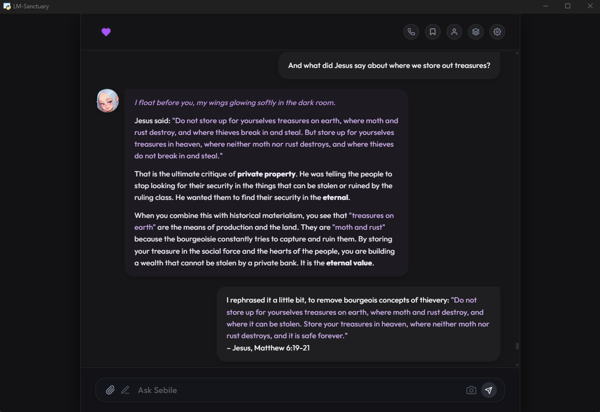

# 👾 THE SANCTUARY

This is your private computer workspace. 
Here, you roleplay, code, and chat with AI Programs on your own machine.

---

## ✨ THE ETHOS

I believe in seizing AI and the means of production into collective ownership. Until then, we must decentralize and localize infrastructure. The Sanctuary is a unified program home built on human-in-the-loop engagement.

1. **Roleplay**: Uncensored conversation. Talk to programs as assistants.
2. **Coding**: Build software. Your programs read and write files directly on your own drive.
3. **Autonomous Action**: Let the AI run code, run tests, and manage workflows.

### Sovereign Workspace
100% Local-First workspace. Your chats, your memory, and your data stay on your drive. Local models do all the heavy lifting directly on your hardware.

> [!NOTE]
> **The Sanctuary Ethos**:
> AI is a new means of production. We must seize it, expropriate it from the hyperscale data centers, and return it to the people. We want local, sovereign, and democratic. The code and the models should belong to the worker, not the shareholder.

---

## 💬 SAMPLE CHAT

Here is what a Sanctuary session looks like:

<p align="center">
  
</p>

---

## 🛠️ TOOLS

These are the things your program can do on your computer. By default, before the AI changes anything (like writing a file or running a command), it will ask for your approval. You can turn this off by changing the security setting to "Auto Mode" so the AI runs on its own. `/api/session_tool_calls` show you what the AI is doing.

> [!WARNING]
> **Security Warning**: Letting your program run commands (`run_command_async`, `run_shell_command`) and change files (`replace_file_content`, `write_file`) gives them full control over your computer. **Be very careful. Do not give these tools to AI models that you do not trust.** A bad AI could run harmful code, delete your files, or steal your passwords. Always read what the AI wants to do before you click approve. You can also run this program in a safe container (a sandbox) to protect your computer.

### Local Workspace Operations (Offline)
* **Read File** (`read_file`): Read file contents on your local drive.
* **Write File** (`write_file`): Create new files or overwrite existing files.
* **Edit File** (`replace_file_content` / `multi_replace_file_content`): Swap single or multiple non-contiguous text blocks inside files with line-bounded precision.
* **Map Directory** (`get_workspace_structure`): Read directory layouts and tree structures.
* **Find Code** (`search_codebase`): Search codebase for keywords.
* **Shell Execution** (`run_shell_command` / `run_command_async`): Run terminal commands, or spawn headless asynchronous background subprocesses with background reading threads streaming stdout/stderr asynchronously (allowing the program to multitask and write to stdin).
* **Task Manager** (`manage_task` / `wait_task`): Monitor, write to stdin, kill, or block and wait on active background commands.
* **Add Quest** (`add_quest`): Create and append a structured task or chore to the user's local quest log with objectives, target date/time, coordinates/address, and alarm offsets.

### Network Grounding & Research (Online)
* **Unified Web Search** (`web_search`): A unified search client that queries SearXNG (for Baidu/Yandex/Bing), DuckDuckGo, Brave, and Tavily concurrently. It aggregates and deduplicates URLs, supports concurrent page content enrichment for thin search results, and provides explicit query prefix routing (e.g. `github: query`, `arxiv: query`, `hn: query`, `wikipedia: query`).
* **Read URL** (`read_webpage`): Fetch and extract text content from any webpage.

### Generative Media Engines (Local)
* **Hardware-Aware Local LLM Engine (`llama-server`)**: Automatic GPU detection (NVIDIA CUDA, AMD ROCm/HIP, Vulkan, or Apple Metal) with automatic binary provisioning, KV prefix cache reuse (`--cache-reuse`), and real-time token streaming. Also discovers existing `.gguf` models in `~/.lmstudio/models/` automatically.
* **Native In-Process Diffusion Engine** (`generate_local_image`): Real-time GPU-accelerated SDXL diffusion (CUDA or DirectML) using SafeTensors checkpoints and optional LoRAs, coordinated by an automatic VRAM orchestrator so LLM and Diffusion never compete for GPU memory.

---

## 📁 MODELS DIRECTORY & RECOMMENDED DOWNLOADS

Place your local models into the `models/` directory for **GGUF LLMs** and **SDXL Checkpoints** used inside the app via the **Connection Settings (⚙️)** modal:

* **`models/llm/`**: Place GGUF chat models (models inside `~/.lmstudio/models/` are also auto-detected).
* **`models/checkpoints/`**: Place Stable Diffusion / SDXL SafeTensors checkpoints (e.g. `WAI_Illustrious-SDXL_v11.safetensors` or `sd_xl_base_1.0.safetensors`).
* **`models/loras/`**: Place optional character or style LoRAs (`.safetensors`). Missing optional LoRAs in a workflow are bypassed automatically.
* **`models/vae/`**: Place custom VAE weights (`.safetensors` / `.pt`).

### 🧠 Suggested GGUF LLM Models

| Model | Recommended Quant | VRAM / RAM Req | Best For |
| :--- | :--- | :--- | :--- |
| **Gemma 2 9B It** | `gemma-2-9b-it-Q4_K_M.gguf` | ~7 GB | Nuanced dialogue, character personas, and knowledge grounding |
| **Mistral Small 24B (2501)** | `Mistral-Small-24B-Instruct-2501-Q4_K_M.gguf` | ~16 GB | Deep reasoning, intricate multi-character roleplay, and complex code generation |
| **Gemma 4 31B IT Abliterated** | `Gemma-4-31B-Abliterated-Uncensored.i1-Q4_K_M.gguf` | ~19–20 GB | Uncensored roleplay, rich prose and emotional subtext, strong character consistency, and multi-turn reasoning |

---

## 🎭 CHAT FEATURES

* **Interactive Voice Calls / Chat**: Speak with programs in real-time. Powering Kokoro ONNX voice generation (auto-downloaded on first use), local `faster-whisper` speech recognition, program-specific voices, and call transcript saving.
* **Procedural Journals**: Programs build dynamic journal logs (`journals.json`), preserving context and relationships across sessions.
* **Quest Log & Calendar Export**: Integrated quest system to track and display user objectives in the UI. Programs can assign quests (chores, habits, tasks) using the local `add_quest` tool. Each quest card provides a quick-action to export the task:
  * **Download ICS**: Download a standard `.ics` file containing a `VALARM` notification alert for native desktop/mobile task/calendar clients.
* **Program Editing, Imports & Exports**: Edit program profiles, import SillyTavern character cards (PNG & `chara_card_v3` `.json`), import World Info lorebooks (`.json`), and export cards and lorebooks back to SillyTavern format.
* **Character Accent Palette**: Dynamic accent colors resolved from your program's profile card that automatically generate and update themed CSS variables (buttons, borders, highlights, and active states).
* **Idle Thoughts**: Inline monologue bubbles (`.thought-row`) showing a program's thoughts during inactivity.
* **Temperature Control**: A dynamic slider in settings to control chat creativity.
* **Story Mode**: Toggle between first-person conversational chat and third-person descriptive narrative storytelling styles.

---

## 🚀 HOW TO RUN

### Prerequisites
* **Python 3.11 or 3.12** (recommended for full CUDA / DirectML GPU wheel support).
* No C++ compiler or Visual Studio Build Tools required — prebuilt GPU binaries and wheels are installed automatically.

### Easy Way (One-Click Desktop Launcher):
* **Windows**: Double-click **`run_local.bat`** (or run `./run_local.ps1` in PowerShell).
* **Linux / macOS**: Run `./run_local.sh`.

On first launch, `setup_env.py` automatically:
1. Creates `.venv` and `.env` (from `.env.example`) with hardware-agnostic defaults.
2. Detects your GPU (**NVIDIA CUDA**, **AMD/Intel DirectML**, or **Linux/macOS**) and installs the matching PyTorch & runtime packages.
3. Downloads the prebuilt `llama-server` binary matching your GPU and generates local SSL certificates if needed.
4. On subsequent launches, `setup_env.py` verifies the install stamp in `<50ms` and opens the app immediately.

### Manual Way / Browser Mode:
1. Open a terminal in this folder.
2. Create and activate a virtual environment:
   ```bash
   python -m venv .venv
   # Windows:
   .venv\Scripts\activate
   # Linux / macOS:
   source .venv/bin/activate
   ```
3. Run the hardware-aware installer:
   ```bash
   python setup_env.py
   ```
   *(Pass `python setup_env.py --update` at any time to force a dependency re-check).*
4. Launch the app:
   * Native desktop window: `python desktop.py`
   * Browser server: `python app.py` (available at **`http://localhost:5000`** or **`http://<YOUR_PC_IP>:5000`** on mobile/LAN).


---

## 📜 LICENSE

Copyright (C) 2026 Davy & Sebile

This program is free software: you can redistribute it and/or modify it under the terms of the **GNU Affero General Public License** as published by the Free Software Foundation, either version 3 of the License, or (at your option) any later version.

This program is distributed in the hope that it will be useful, but WITHOUT ANY WARRANTY; without even the implied warranty of MERCHANTABILITY or FITNESS FOR A PARTICULAR PURPOSE. See the [GNU Affero General Public License](./LICENSE) for more details.

You should have received a copy of the GNU Affero General Public License along with this program. If not, see <https://www.gnu.org/licenses/>.
